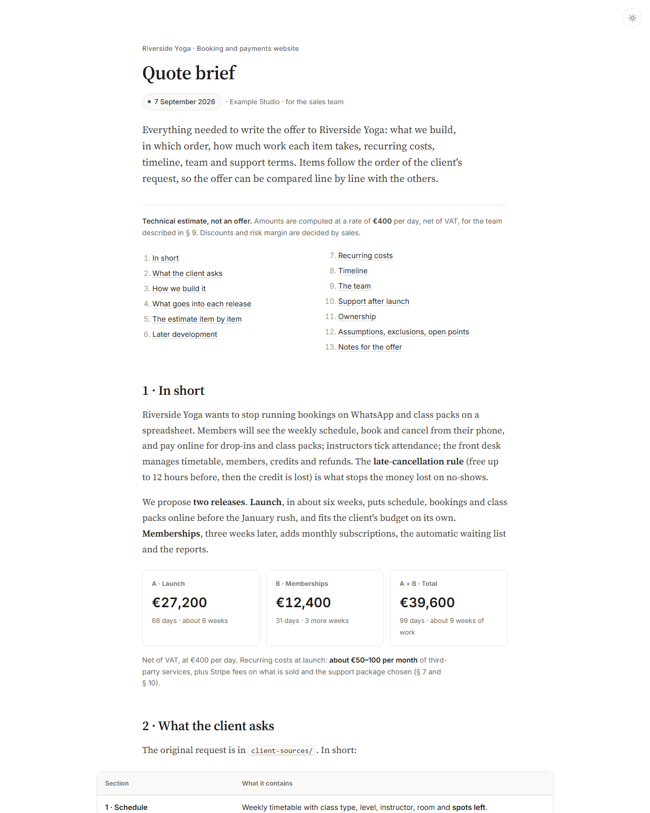

# quote-to-code

**Dalla richiesta di preventivo del cliente al progetto consegnato, e ritorno a
stime migliori.** Un insieme di skill per [Claude Code](https://claude.com/claude-code)
e piccoli strumenti Python per software house e freelance.

[English](README.md) · [Progetto di esempio](examples/riverside-yoga/) · licenza MIT

Realizzato da [TouchSite Software](https://www.touchsitesoftware.it).



## Perché

Gli strumenti di sviluppo guidato dalle specifiche aiutano a scrivere codice
partendo dalle specifiche. Ma per una software house il lavoro comincia prima
— un'email del cliente, una scadenza, un budget — ed è lì che si fanno gli
errori più cari: una stima sbagliata, un punto aperto dimenticato, un perimetro
che nessuno ha scritto.

quote-to-code copre **tutto il ciclo**:

| Fase | Comando | Cosa produce |
| --- | --- | --- |
| 1 · Prevendita | `/new-project` | Cartella del progetto, stima voce per voce, **scheda per il preventivo** (HTML e PDF), infrastruttura con schema, documenti tecnici, ADR |
| 2 · Avvio | `/start-project` | Quando il cliente firma: una **modifica** per ogni voce di stima, con requisiti, scenari, attività e giornate |
| 3 · Sviluppo | `/explore` · `/propose` · `/apply` · `/verify` · `/archive` | Ogni cambiamento scritto prima, costruito con i test, verificato, consolidato nelle specifiche |
| 4 · Chiusura | `/close-project` | Giornate stimate e reali voce per voce, riportate nel **listino** |

Il punto è la fase 4: ogni progetto chiuso migliora la stima successiva.

## Cosa lo rende diverso

- **I numeri non si scrivono a mano.** Le giornate stanno in `estimate.py`, che
  scrive ogni tabella e ogni cifra della scheda.
- **Il tuo listino è la regola.** Tariffe, team, pacchetti di assistenza,
  giornate di riferimento e regole stanno in un `pricing.md` che le skill
  considerano vincolante.
- **Scritto per il commerciale, non solo per gli sviluppatori.** La scheda
  spiega le scelte in parole semplici: cosa c'è in ogni rilascio e perché,
  punti aperti, rischi, costi ricorrenti.
- **Specifiche che si controllano.** Requisiti con DEVE e scenari
  QUANDO/ALLORA, verificati da uno script, legati alle giornate che costano.
- **Italiano e inglese.** Si sceglie la lingua per progetto; parole chiave,
  modelli e controlli la seguono.
- **Nessun vincolo.** Markdown, HTML, Python standard. Nessun server, nessun
  account, nessuna telemetria.

## Per cominciare

Servono: Python 3.9+, Git, Chrome/Edge/Chromium (per i PDF), Claude Code.

```sh
git clone https://github.com/thetouchsite/quote-to-code
cd quote-to-code
cp company.example.json company.json      # nome dell'azienda, lingua ("it"), tariffe
cp pricing.example.it.md pricing.md       # tariffe, team, giornate di riferimento
claude
```

Poi in Claude Code:

```text
/new-project
Progetto: Gestionale Rossi
<incolla l'email del cliente>
```

Dopo qualche minuto c'è `../GestionaleRossi/` con stima, scheda e PDF,
infrastruttura, documenti tecnici e l'elenco dei punti aperti da chiarire col
cliente. Il risultato finito è in [`examples/riverside-yoga/`](examples/riverside-yoga/)
(in inglese).

Quando il cliente firma: `/start-project`. Poi si apre Claude Code **nella
cartella del progetto** e si lavora modifica per modifica con `/propose`,
`/apply`, `/verify`, `/archive`.

## Senza Claude

```sh
python new_project.py "Nome Progetto" richiesta.txt --client "Cliente" --lang it
python update_project.py ../NomeProgetto --dry-run

# dentro un progetto
python docs/estimate/estimate.py         # riscrive tabelle e cifre della scheda
python tools/make_pdf.py                 # scheda → PDF
python tools/changes.py list             # modifiche aperte, avanzamento, giornate
python tools/changes.py check            # formato di specifiche e modifiche
python tools/changes.py actuals          # giornate stimate e reali
```

`company.json`, `pricing.md` e `requests/` sono esclusi da git: tariffe e
clienti restano sulla tua macchina.

## Contribuire

Segnalazioni e pull request sono benvenute: vedi [CONTRIBUTING.md](CONTRIBUTING.md).

## Licenza

[MIT](LICENSE) © 2026 TouchSite Software.
