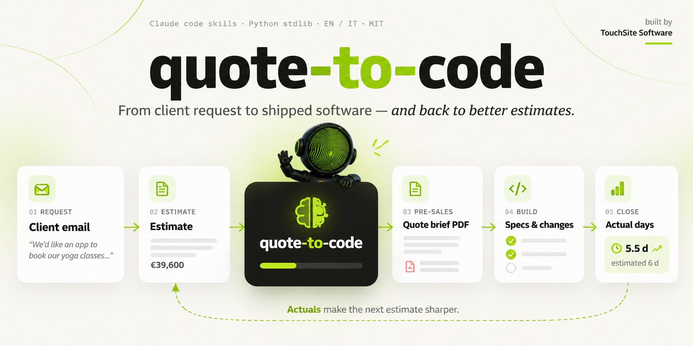
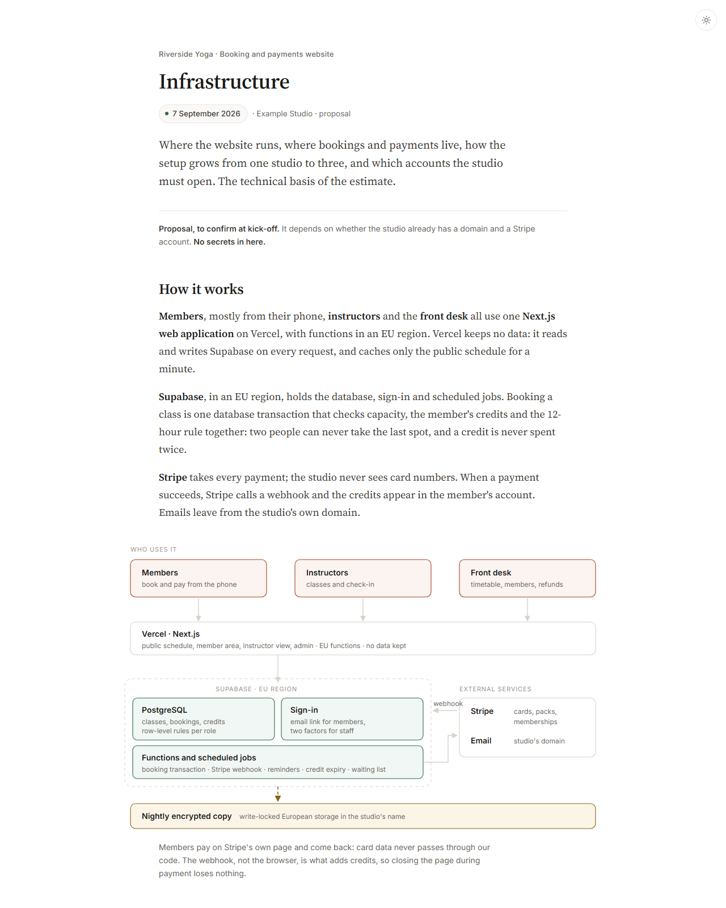

# quote-to-code



**From a client's request for a quote to a delivered project — and back to
better estimates.** A set of [Claude Code](https://claude.com/claude-code)
skills and small Python tools for software studios and freelancers.

[Italiano](README.it.md) · [Example project](examples/riverside-yoga/) · MIT licence

Built by [TouchSite Software](https://www.touchsitesoftware.it).


## Why

Spec-driven tools help you write code from specs. But for a studio the work
starts earlier — a client email, a deadline, a budget — and the most expensive
mistakes are made there: a wrong estimate, a missing open point, a scope that
nobody wrote down.

quote-to-code covers the **whole loop**:

| Phase | Command | What you get |
| --- | --- | --- |
| 1 · Pre-sales | `/new-project` | Project folder, item-by-item estimate, a **quote brief** for sales (HTML + PDF), infrastructure proposal with diagram, technical docs, ADRs |
| 2 · Kick-off | `/start-project` | When the client signs: one **change** per estimate item, with requirements, scenarios, tasks and days |
| 3 · Development | `/explore` · `/propose` · `/apply` · `/verify` · `/archive` | Every change written first, built with tests, verified, merged into living specs |
| 4 · Close | `/close-project` | Estimated vs actual days, item by item, fed back into your **pricing file** |

Step 4 is the point: every finished project makes the next estimate better.

## What makes it different

- **Numbers are never typed by hand.** Days live in `estimate.py`; it writes
  every table and every figure in the brief. Change a line, rerun, done.
- **Your pricing is the rulebook.** Rates, team, support packages, reference
  days and rules live in one `pricing.md` that the skills treat as binding.
- **Written for sales, not only for developers.** The brief explains choices
  in plain language: what is in each release and why, open points, risks,
  recurring costs.
- **Specs with teeth.** Requirements with SHALL and WHEN/THEN scenarios,
  checked by a script, tied to the days they cost.
- **Italian and English.** Pick the language per project; keywords, templates
  and checks follow it.
- **No lock-in.** Markdown, HTML, Python standard library. No server, no
  account, no telemetry.



## Quick start

Requirements: Python 3.9+, Git, Chrome/Edge/Chromium (for PDFs), Claude Code.

```sh
git clone https://github.com/thetouchsite/quote-to-code
cd quote-to-code
cp company.example.json company.json      # your company name, language, rates
cp pricing.example.md pricing.md          # your rates, team, reference days (pricing.example.it.md in Italian)
claude
```

Then in Claude Code:

```text
/new-project
Project: Riverside Yoga
<paste the client's email>
```

A few minutes later you have `../RiversideYoga/` with the estimate, the brief
and its PDF, the infrastructure, the technical docs, and a list of open points
to discuss with the client. See the finished result in
[`examples/riverside-yoga/`](examples/riverside-yoga/): open
[`docs/index.html`](examples/riverside-yoga/docs/index.html) or the
[PDF](examples/riverside-yoga/docs/sales/Quote-brief.pdf).

When the client signs:

```text
/start-project
Riverside Yoga, the Launch release was signed
```

Then open Claude Code **in the project folder** and work change by change:

```text
/propose class-packs
/apply class-packs
/verify class-packs
/archive class-packs
```

## Without Claude

Everything mechanical is plain Python:

```sh
python new_project.py "Project Name" request.txt --client "Client" --lang en   # empty documentation set
python update_project.py ../ProjectName --dry-run                               # sync skills and tools
python update_project.py --all                                                  # every generated project

# inside a project
python docs/estimate/estimate.py         # rewrite the brief's tables and figures
python tools/make_pdf.py                 # brief → PDF
python tools/changes.py list             # open changes, progress, days
python tools/changes.py check            # format of specs and changes
python tools/changes.py actuals          # estimated vs actual days
```

## What a project looks like

```text
RiversideYoga/
  CLAUDE.md                  phase, stack, rules for Claude
  .claude/skills/            explore, propose, apply, verify, archive
  docs/
    sales/Quote-brief.html   the brief for sales, and its PDF
    estimate/estimate.py     the single source of every number
    infrastructure/          setup proposal with SVG diagram
    technical/               architecture, data model, GDPR, ADRs
    client-sources/          the original request
  specs/                     what the system does today
  changes/                   work in progress; archive/ for finished work
  tools/                     changes.py, make_pdf.py
```

## Repository layout

| Path | What |
| --- | --- |
| `.claude/skills/` | `new-project`, `start-project`, `close-project` |
| `templates/common/` | Copied into every project: development skills, tools, estimate script, styles |
| `templates/en/`, `templates/it/` | Language-specific documents and change templates |
| `examples/riverside-yoga/` | A complete fictional project, in pre-sales and mid-development |
| `pricing.example.md` | Example pricing file to copy into `pricing.md` |
| `company.example.json` | Example company settings to copy into `company.json` |
| `new_project.py`, `update_project.py` | Create a project; sync tools into existing projects |

`company.json`, `pricing.md` and `requests/` are git-ignored: your rates and
your clients stay on your machine.

## Contributing

Issues and pull requests are welcome: see [CONTRIBUTING.md](CONTRIBUTING.md).
New languages are especially welcome — a language is a `templates/<lang>/`
folder plus a vocabulary entry in `tools/changes.py`.

## Licence

[MIT](LICENSE) © 2026 TouchSite Software.
