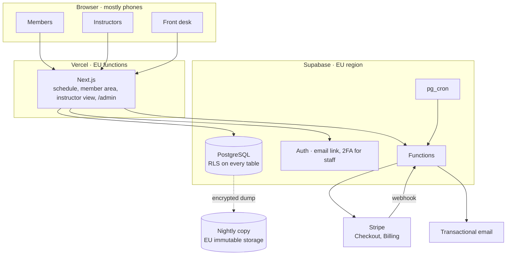

# Architecture

Riverside Yoga is a booking and payments website for a two-room yoga studio:
members book and pay from their phone, instructors tick attendance, the front
desk runs the timetable. This document describes how the system is built; the
reasons for the choices are in [`adr/`](adr/).

## Components



| Component | Technology | Responsibility |
| --- | --- | --- |
| Web application | Next.js (App Router), TypeScript | Public schedule (server-rendered, cached one minute), member area, instructor view, admin under `/admin` |
| Database | PostgreSQL 15+ | Classes, bookings, credits ledger, memberships; booking rules as SQL functions |
| Auth | Supabase Auth | Email magic link for members, password + TOTP for staff |
| Functions | Supabase Edge Functions | Stripe webhook, emails, waiting-list promotion |
| Scheduled jobs | `pg_cron` | Reminders the day before, credit expiry, no-show marking after class |
| Payments | Stripe Checkout and Billing | Drop-ins and packs (Launch), memberships (second release) |

## Code layout

```text
apps/web/                 Next.js: public pages, /account, /teach, /admin
packages/core/            types, zod schemas, booking rules mirrored for the UI
supabase/migrations/      the only way to change the database
supabase/functions/       stripe-webhook, send-email, promote-waitlist
supabase/tests/           pgTAP: RLS per role, booking transaction edge cases
```

## Modules and days

| Module | Main tables | Days (A + B) | Document |
| --- | --- | --- | --- |
| Website and weekly schedule | `class_types`, `class_series`, `sessions`, `rooms`, `instructors` | 6 + 0 | |
| Accounts and member area | `profiles`, `consents` | 3 + 1 | [data-model.md](data-model.md) |
| Booking and cancellation rules | `bookings` | 6 + 1 | [bookings-and-credits.md](bookings-and-credits.md) |
| Drop-ins and class packs | `products`, `purchases`, `credit_ledger` | 7 + 0 | [bookings-and-credits.md](bookings-and-credits.md) |
| Monthly memberships | `memberships` | 0 + 6 | [adr/0002-stripe-for-packs-and-memberships.md](adr/0002-stripe-for-packs-and-memberships.md) |
| Waiting list | `waitlist_entries` | 0 + 3 | [bookings-and-credits.md](bookings-and-credits.md) |
| Instructor view | `bookings.attended_at` | 3 + 1 | |
| Admin panel and reports | views over the tables above, `admin_log` | 7 + 3, 0 + 3 | |

## Key flows

**Book a class.** The member taps «Book» → the server calls
`book_session(session_id)` → in one transaction the function locks the
session row, checks capacity, the member's valid credits or membership and the
booking window, inserts the booking and a `-1` ledger entry → the email
function sends the confirmation. Any failed check returns a clear reason
(«class full», «no credits», «booking closed»).

**Buy a pack.** The member picks «10 classes» → Stripe Checkout → on
`checkout.session.completed` the webhook inserts the purchase and a `+10`
ledger entry with its expiry date. The browser never adds credits.

**Cancel.** More than 12 hours before the start: the booking is cancelled and
a `+1` refund entry is added. Later: the booking is cancelled, no refund.

## Observability

Errors from web and functions to an error monitoring service; alerts on failed
Stripe webhooks, failed emails, missed backups.
