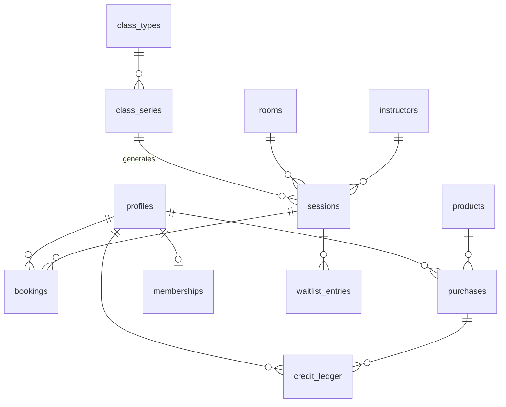

# Data model

Conventions: `uuid` keys, `timestamptz` times in UTC shown in the studio's
time zone, amounts in cents, `created_at` / `updated_at` everywhere. **Every
table has RLS on.**

| Table | Main fields |
| --- | --- |
| `profiles` | `id` (= `auth.users.id`), name, phone, role (`member` · `instructor` · `front_desk` · `owner`), marketing consent |
| `consents` | profile, kind, notice version, granted/revoked, date |
| `rooms` | name, capacity |
| `instructors` | profile, bio, photo, active |
| `class_types` | name, level, description, duration |
| `class_series` | class type, room, instructor, weekday, start time, valid from/to: the weekly repeat |
| `sessions` | series (or none for one-offs), room, instructor, starts at, capacity override, cancelled |
| `bookings` | session, member, status (`booked` · `cancelled` · `late_cancelled` · `no_show` · `attended`), booked at, cancelled at, attended at, ledger entry |
| `products` | kind (`drop_in` · `pack` · `membership`), credits, validity in days, price, Stripe price id, active |
| `purchases` | member, product, Stripe checkout or invoice id, amount, status |
| `credit_ledger` | member, kind (`purchase` · `booking` · `refund` · `adjustment` · `expiry`), amount, expires at (purchases only), booking, purchase, reason, created by |
| `memberships` | member, Stripe subscription id, status, current period end (second release) |
| `waitlist_entries` | session, member, position, promoted at (second release) |
| `studio_settings` | booking window, cancellation hours, time zone |
| `admin_log` | who, action, target, before/after, when — insert only |
| `stripe_events` | event id (unique), type, processed at: makes webhooks idempotent |

## Sessions from series

The front desk edits **series** («Vinyasa, Tuesday 18:30, Room 1, Marta»). A
nightly job keeps `sessions` generated eight weeks ahead. Changing a series
changes only future sessions without bookings; sessions with bookings are
listed for the front desk to decide (move, cancel and refund).

## Access rules

- a member reads public schedule data, and only their own bookings, ledger,
  purchases and membership;
- an instructor also reads the bookings of their own sessions and can set
  `attended_at`;
- front desk and owner read and write everything except `admin_log` (insert
  only, via functions) and `stripe_events` (functions only);
- `book_session` and `cancel_booking` are the only way for a member to write a
  booking.
